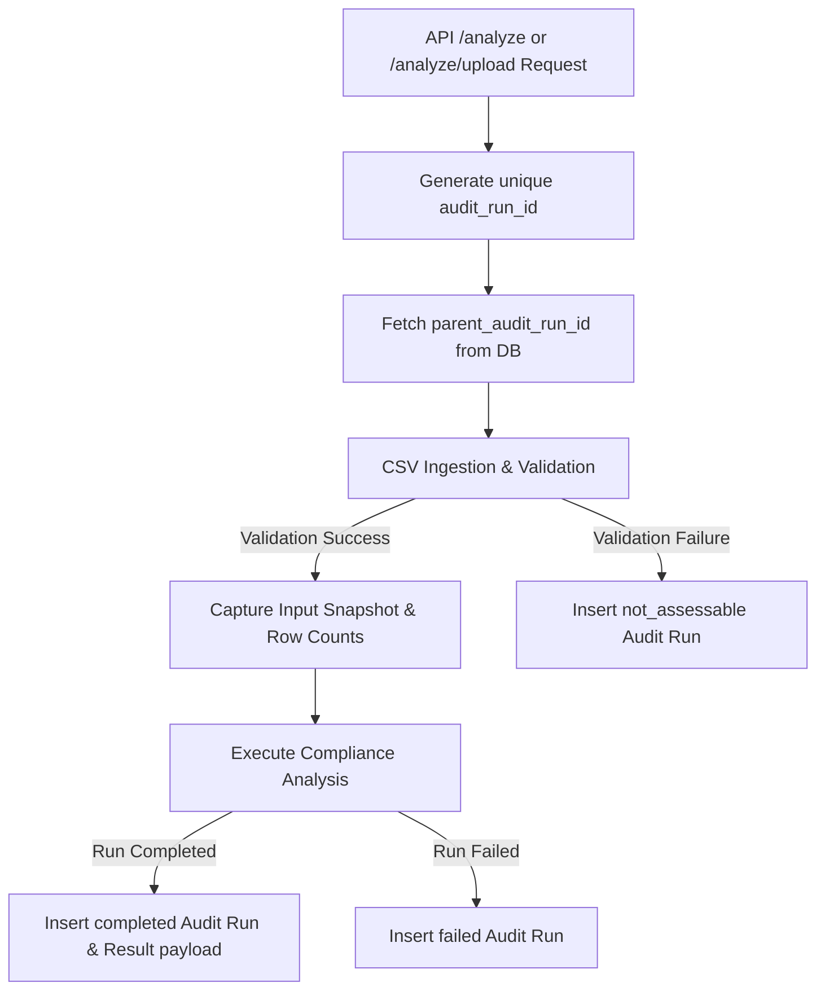

# Audit Run Model & Lineage Documentation

This document describes the immutable audit-run model, hash sources, lifecycle, selection rules, and re-analysis lineage implemented in the compliance engine.

## 1. Schema & Persistent Fields

Audit runs are persisted in the `public.audit_runs` table, which holds the following immutable fields:
- `audit_run_id` (PK): A unique, cryptographically secure identifier generated at the start of every analysis run (e.g. `run_<uuid>`).
- `tenant_id`: The ID of the authorized tenant.
- `input_snapshot_hash`: The SHA-256 hash of the tenant database state, representing a deterministic signature of all database rows belonging to the tenant.
- `rule_set_hash`: SHA-256 hash of the canonical rules metadata configuration file (`data/dpdp_kb/dpdp_rules.json`).
- `clause_set_hash`: SHA-256 hash of the canonical clauses definition configuration file (`data/dpdp_kb/clauses.json`).
- `engine_version`: Version of the evaluation engine executing the check (`2.0.0`).
- `model_hash`: Identifier of any machine learning inference models loaded for risk calibration.
- `source_data_row_counts`: A JSONB mapping containing row counts for all tenant source files/tables.
- `validation_summary`: JSONB summary containing any validation errors or success messages.
- `status`: `completed`, `failed`, or `not_assessable`.
- `parent_audit_run_id`: The audit run ID of the preceding execution run for this tenant, capturing the lineage of re-analysis.
- `created_at`: Datetime timestamp of when the run was executed.

---

## 2. Hashing Sources & Determinism

### Input Snapshot Hash
The snapshot hash is computed deterministically:
1. Fetch all rows belonging to the tenant from all raw tables (`customer_master`, `consent_records`, `transaction_events`, `access_logs`, `data_lifecycle`, `security_events`, `dsar_requests`, `system_inventory`, `policies`, `governance_config`).
2. Sort key-value pairs of each row, convert to strings, and sort all serialized rows deterministically.
3. Feed the sorted sequence of rows into SHA-256 hash updater.
This guarantees that the input snapshot hash will be identical if and only if the underlying data values remain identical.

### KB Configuration Hashes
Rule and Clause set hashes are generated directly from the content of their source JSON files on disk using SHA-256. This ensures rule updates or clause updates are immediately visible as new hashes, while unmodified configurations produce stable baseline hashes.

---

## 3. Audit-Run Lifecycle

- **Lineage Preservation**: Completed and failed runs are never mutated. Re-analysis or new file uploads trigger a brand-new run entry. The latest run references the preceding one via `parent_audit_run_id`.

---

## 4. Selection Rule & Contract

To ensure absolute consistency across API responses, dashboard views, and PDF report generation, components must never independently select the "latest" run.

### API/Dashboard/PDF Selection Contract
Every entry point in the system follows a unified parameter tracing protocol:
- **Explicit Parameter**: The POST `/analyze` endpoint, GET `/dashboard/{tenant_id}`, and GET `/report/pdf/{tenant_id}` endpoints all accept an explicit `audit_run_id` parameter.
- **Centralized Default Rule**: If the request lacks an `audit_run_id`:
  1. The API-boundary default rule queries the `audit_runs` table for the most recent completed run ID (`status = 'completed'`) belonging to that tenant.
  2. If none exists, a `404 Not Found` exception is raised.
  3. Once resolved, this ID is exposed back in the payload and passed unchanged to all sub-services (including the PDF generator).
- **No Independent Queries**: Neither the PDF generator nor the dashboard queries the database for the "latest" record on their own; they strictly require the resolved `audit_run_id` to be passed down.
- **Authorization & Isolation**: Any request requesting an `audit_run_id` belonging to a different tenant is immediately rejected with a `404 Not Found` across all endpoints consistently.
