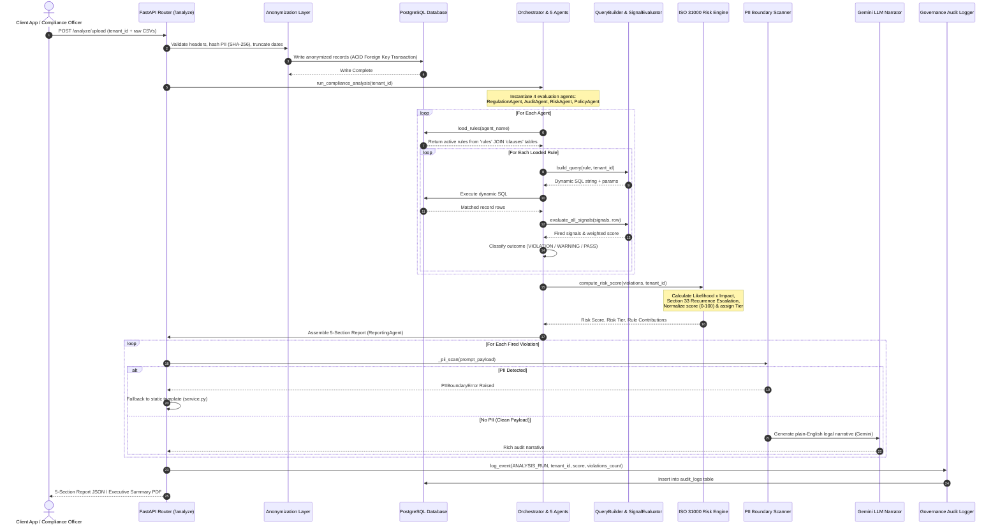
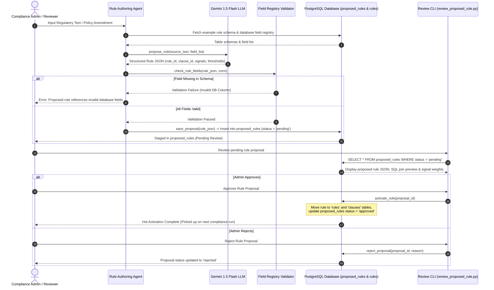

# Comprehensive System Workflow & Technical/Business Evaluation Report

**System Name:** Enterprise DPDP Compliance Engine, Dynamic Rule Authoring & Governance System  
**Target Regulation:** Digital Personal Data Protection (DPDP) Act, 2023 (India)  
**Document Type:** Final Architecture, New System Workflow & Justification Report  
**Location:** `/docs/final_workflow.md`  

---

## Executive Summary

The **DPDP Compliance Engine** is an enterprise-grade, privacy-preserving compliance audit, rule-authoring, and governance framework designed to evaluate enterprise and FinTech data ecosystems against the Digital Personal Data Protection (DPDP) Act, 2023.

### Key Architectural Evolution (The New System Workflow)

Unlike static or hardcoded compliance engines, the system features a **dynamic, database-driven rules engine**, a **dual-path workflow** (combining deterministic compliance evaluation with AI-assisted rule authoring), an **expanded 5-agent operational architecture**, and a **self-governing framework**.

Key properties of the updated workflow include:

1. **Dynamic Database-Driven Rules Engine:** All compliance rules live in PostgreSQL (`rules` and `clauses` tables). Evaluation agents are lightweight execution loops that load active rules from the database at runtime. Adding or updating rules requires zero code changes or redeployments.
2. **Generic Query Building & Signal Evaluation:** A single parameterized engine ([query_builder.py](file:///c:/Users/Rasika/Documents/compliance_sys/src/agent_layer/query_builder.py) and [signal_evaluator.py](file:///c:/Users/Rasika/Documents/compliance_sys/src/agent_layer/signal_evaluator.py)) dynamically constructs SQL queries from rule table specifications and evaluates evidence signals across all supported logical operators.
3. **5 Operational Agents:** The engine expands from 3 to 5 domain agents (`RegulationAgent`, `AuditAgent`, `RiskAgent`, `PolicyAgent`, and `ReportingAgent`).
4. **AI-Assisted Dynamic Rule Authoring Lifecycle:** A parallel workflow allows regulatory amendments or internal policy changes to be converted by an LLM (Gemini) into structured rule JSON, validated against the database schema by a `FieldRegistry`, staged in a `proposed_rules` table, reviewed by a human compliance officer, and hot-activated into the live rules table.
5. **Dual Explainability Architecture with PII Boundary Interceptor:** Compliance decision-making, scoring, and tiering remain **100% deterministic**. Plain-English audit narratives are generated using Gemini LLM, guarded by an outbound **PII Boundary Scanner** that automatically blocks any prompt containing PII (emails, phone numbers, Aadhaar numbers, account numbers) and falls back to deterministic template explanations.
6. **Enterprise Governance Layer:** Includes an append-only audit logger ([audit_logger.py](file:///c:/Users/Rasika/Documents/compliance_sys/src/governance/audit_logger.py)), Role-Based Access Control ([auth.py](file:///c:/Users/Rasika/Documents/compliance_sys/src/governance/auth.py)), and tenant bias monitoring ([bias_monitor.py](file:///c:/Users/Rasika/Documents/compliance_sys/src/governance/bias_monitor.py)).
7. **Forward-Compatible JSONB Schema:** All core schema tables feature an `additional_attributes JSONB` column, enabling new data fields to be added and queried without DDL schema migrations.

---

## 1. System Architecture & Core Component Map

```
┌────────────────────────────────────────────────────────────────────────────────────────────────────────┐
│                                       CLIENT API & INTERFACE LAYER                                     │
│         POST /analyze/upload    │    POST /analyze    │    CLI Reviewer    │    Streamlit UI         │
└──────────────────────────────────────────────────┬─────────────────────────────────────────────────────┘
                                                   │
         ┌─────────────────────────────────────────┴────────────────────────────────────────┐
         │                                                                                  │
         ▼                                                                                  ▼
┌──────────────────────────────────────────────┐                   ┌─────────────────────────────────────┐
│    PATH A: DATA INGESTION & COMPLIANCE EVAL   │                   │    PATH B: DYNAMIC RULE AUTHORING   │
│                                              │                   │                                     │
│ ┌──────────────────────────────────────────┐ │                   │  Regulatory Text / Policy Amendment │
│ │ Ingestion & Privacy Gate                 │ │                   │                  │                  │
│ │ - csv_loader (intake & schema check)     │ │                   │                  ▼                  │
│ │ - field_mapper (SHA-256 PII hashing,     │ │                   │  Rule Authoring Agent (Gemini LLM)  │
│ │   timestamp truncation, enum normalize)  │ │                   │  Proposes structured rule JSON      │
│ │ - db_writer (ACID FK transaction)        │ │                   │                  │                  │
│ └────────────────────┬─────────────────────┘ │                   │                  ▼                  │
│                      │ Anonymized Data       │                   │  Field Registry Schema Validation   │
│                      ▼                       │                   │  Verifies signal fields in DB       │
│ ┌──────────────────────────────────────────┐ │                   │                  │                  │
│ │ PostgreSQL Database                      │ │                   │                  ▼                  │
│ │ - Data Tables (with JSONB attributes)    │ │                   │  Staging (proposed_rules table)     │
│ │ - rules & clauses tables (Live Rules)    │ │                   │                  │                  │
│ └────────────────────┬─────────────────────┘ │                   │                  ▼                  │
│                      │ Load Rules at Runtime │                   │  Human Review & Governance         │
│                      ▼                       │                   │  Approve / Reject via CLI / UI     │
│ ┌──────────────────────────────────────────┐ │                   │                  │                  │
│ │ Orchestrator & 5 Evaluation Agents       │ │                   │                  ▼                  │
│ │ - RegulationAgent                        │ │                   │  Hot Activation into Live Rules DB  │
│ │ - AuditAgent                             │ │                   └──────────────────┬──────────────────┘
│ │ - RiskAgent                              │ │                                      │ Picked up on
│ │ - PolicyAgent                            │ │                                      │ next run
│ │ - ReportingAgent                         │ │◄─────────────────────────────────────┘
│ └────────────────────┬─────────────────────┘ │
│                      │ Raw ViolationRecords  │
│                      ▼                       │
│ ┌──────────────────────────────────────────┐ │
│ │ Scoring & Dual Explainability Layer      │ │
│ │ - ISO 31000 / NIST Likelihood x Impact   │ │
│ │ - Risk Tiering & Sec 33 Recurrence       │ │
│ │ - PII Boundary Scanner (Intercepts PII) │ │
│ │ - LLM Narration (Gemini) / Deterministic │ │
│ │   Fallback                               │ │
│ └────────────────────┬─────────────────────┘ │
└──────────────────────┼───────────────────────┘
                       │
                       ▼
┌────────────────────────────────────────────────────────────────────────────────────────────────────────┐
│                                 ENTERPRISE GOVERNANCE & REPORT OUTPUT                                  │
│   5-Section Report Payload   │   Audit Logger (audit_logs DB)   │   RBAC Auth   │   Bias Monitor       │
└────────────────────────────────────────────────────────────────────────────────────────────────────────┘
```

### Module Breakdown

| Directory / Module | Role & Purpose | Key Files |
| :--- | :--- | :--- |
| `src/anonymization` | Pre-ingestion privacy gate. Validates CSV inputs, hashes primary PII keys with SHA-256, truncates timestamps, normalizes enums, and executes atomic DB transactions. | [csv_loader.py](file:///c:/Users/Rasika/Documents/compliance_sys/src/anonymization/csv_loader.py), [field_mapper.py](file:///c:/Users/Rasika/Documents/compliance_sys/src/anonymization/field_mapper.py), [db_writer.py](file:///c:/Users/Rasika/Documents/compliance_sys/src/anonymization/db_writer.py) |
| `src/agent_layer` | Core compliance orchestrator and 5 evaluation agents. Dynamically fetches rules from PostgreSQL and executes generic SQL query evaluation. | [orchestrator.py](file:///c:/Users/Rasika/Documents/compliance_sys/src/agent_layer/orchestrator.py), [base_agent.py](file:///c:/Users/Rasika/Documents/compliance_sys/src/agent_layer/base_agent.py), [rule_loader.py](file:///c:/Users/Rasika/Documents/compliance_sys/src/agent_layer/rule_loader.py), [query_builder.py](file:///c:/Users/Rasika/Documents/compliance_sys/src/agent_layer/query_builder.py), [signal_evaluator.py](file:///c:/Users/Rasika/Documents/compliance_sys/src/agent_layer/signal_evaluator.py), [regulation_agent.py](file:///c:/Users/Rasika/Documents/compliance_sys/src/agent_layer/regulation_agent.py), [audit_agent.py](file:///c:/Users/Rasika/Documents/compliance_sys/src/agent_layer/audit_agent.py), [risk_agent.py](file:///c:/Users/Rasika/Documents/compliance_sys/src/agent_layer/risk_agent.py), [policy_agent.py](file:///c:/Users/Rasika/Documents/compliance_sys/src/agent_layer/policy_agent.py), [reporting_agent.py](file:///c:/Users/Rasika/Documents/compliance_sys/src/agent_layer/reporting_agent.py), [rule_authoring_agent_f.py](file:///c:/Users/Rasika/Documents/compliance_sys/src/agent_layer/rule_authoring_agent_f.py) |
| `src/explainability` | Dual explainability architecture. Combines deterministic scoring and fallbacks with Gemini LLM narrative generation, guarded by an outbound PII Boundary Scanner. | [llm_narrator.py](file:///c:/Users/Rasika/Documents/compliance_sys/src/explainability/llm_narrator.py), [service.py](file:///c:/Users/Rasika/Documents/compliance_sys/src/explainability/service.py), [report_builder.py](file:///c:/Users/Rasika/Documents/compliance_sys/src/explainability/report_builder.py) |
| `src/governance` | Enterprise self-compliance layer providing append-only audit trails, RBAC permission checks, and tenant segment bias monitoring. | [audit_logger.py](file:///c:/Users/Rasika/Documents/compliance_sys/src/governance/audit_logger.py), [auth.py](file:///c:/Users/Rasika/Documents/compliance_sys/src/governance/auth.py), [bias_monitor.py](file:///c:/Users/Rasika/Documents/compliance_sys/src/governance/bias_monitor.py) |
| `db` | Database schema definitions, migration scripts, rule seeders, and proposed rule staging tables. | [schema.sql](file:///c:/Users/Rasika/Documents/compliance_sys/db/schema.sql), [create_proposed_rules_table.sql](file:///c:/Users/Rasika/Documents/compliance_sys/db/create_proposed_rules_table.sql), [migrate_rules_to_db.py](file:///c:/Users/Rasika/Documents/compliance_sys/db/migrate_rules_to_db.py) |

---

## 2. Comprehensive System Workflows

The platform operates two primary workflows: **Workflow Path A (Compliance Analysis & Reporting)** and **Workflow Path B (Dynamic Rule Authoring & Approval)**.

### Sequence Diagram: Workflow Path A — Dynamic Compliance Analysis & Governance



---

### Sequence Diagram: Workflow Path B — Dynamic AI-Assisted Rule Authoring



---

## 3. Step-by-Step Breakdown of the New System Workflow

### Step 1: Privacy Gate & Intake Validation (`src/anonymization/`)
- **CSV Intake ([csv_loader.py](file:///c:/Users/Rasika/Documents/compliance_sys/src/anonymization/csv_loader.py)):** Validates incoming tenant CSVs, enforces required schema headers, and filters all records strictly by `tenant_id` to maintain multi-tenant boundary integrity.
- **Anonymization Engine ([field_mapper.py](file:///c:/Users/Rasika/Documents/compliance_sys/src/anonymization/field_mapper.py)):** Applies Privacy-by-Design transformations before persistence:
  - Hashing user IDs, phone numbers, and emails with salted SHA-256.
  - Truncating timestamp fields to date granularity (`YYYY-MM-DD`).
  - Bucketing numeric counts and stripping cleartext PII.
- **Transactional DB Writer ([db_writer.py](file:///c:/Users/Rasika/Documents/compliance_sys/src/anonymization/db_writer.py)):** Executes relational table insertions into PostgreSQL within an atomic ACID transaction. Automatically inserts placeholder parent records when required by foreign keys.

### Step 2: Dynamic Multi-Agent Compliance Engine (`src/agent_layer/`)
- **Thin Agent Architecture:** Each of the 4 evaluation agents (`RegulationAgent`, `AuditAgent`, `RiskAgent`, `PolicyAgent`) inherits from [base_agent.py](file:///c:/Users/Rasika/Documents/compliance_sys/src/agent_layer/base_agent.py). Agent files no longer contain hardcoded rule logic; each executes a lightweight execution loop over dynamic rules.
- **Runtime Rule Loading ([rule_loader.py](file:///c:/Users/Rasika/Documents/compliance_sys/src/agent_layer/rule_loader.py)):** Executes runtime database queries:
  ```sql
  SELECT r.*, c.max_penalty_crore 
  FROM rules r
  JOIN clauses c ON r.clause_id = c.clause_id
  WHERE r.assigned_agent = %s AND r.enabled = TRUE 
  ORDER BY r.rule_id
  ```
- **Generic SQL Query Construction ([query_builder.py](file:///c:/Users/Rasika/Documents/compliance_sys/src/agent_layer/query_builder.py)):** Generates dynamic parameterized SQL from the rule's primary table, optional join tables ([join_tables](file:///c:/Users/Rasika/Documents/compliance_sys/src/agent_layer/query_builder.py)), and foreign key join conditions ([join_key](file:///c:/Users/Rasika/Documents/compliance_sys/src/agent_layer/query_builder.py)).
- **Generic Signal Evaluation ([signal_evaluator.py](file:///c:/Users/Rasika/Documents/compliance_sys/src/agent_layer/signal_evaluator.py)):** Evaluates rule evidence signals against fetched record rows across all supported comparison operators (`equals`, `not_equals`, `in`, `not_in`, `greater_than`, `less_than`, `is_null`, `is_not_null`, `not_matches`).
- **Outcome Classification:** Evaluates calculated rule score against rule-specific thresholds (`violation_threshold` and `risk_threshold`) to assign `VIOLATION`, `WARNING`, or `PASS`.

### Step 3: ISO 31000 / NIST Aligned Risk Scoring & Tiering (`orchestrator.py`)
- **Likelihood ($L$):** Measures prevalence ratio ($\text{affected\_rows} / \text{total\_rows}$) multiplied by DPDP Act Section 33 recurrence escalation factor:
  $$\text{Recurrence Factor} = 1.0 + \min\left(0.10 \times (\text{affected\_rows} - 1),\, 0.50\right)$$
  $$L = \text{Prevalence Ratio} \times \text{Recurrence Factor}$$

- **Impact ($I$):** Blends severity score, normalized statutory penalty exposure, and maximum signal strength:
  $$I = 0.4 \times \text{Severity Score} + 0.3 \times \left(\frac{\text{Penalty Crore}}{250}\right) + 0.3 \times \text{Signal Strength}$$

- **Per-Rule Inherent Risk:** $R = L \times I \times \text{Risk Weight}$

- **Normalized Risk Score:**
  $$\text{Risk Score} = \min\left( \left( \frac{\sum R}{\text{Max Possible Score}} \right) \times 100,\, 100.0 \right)$$

- **Risk Tier Classification:**
  - `COMPLIANT`: 0.00
  - `LOW`: 0.01 – 29.99
  - `MEDIUM`: 30.00 – 54.99
  - `HIGH`: 55.00 – 74.99
  - `CRITICAL`: 75.00 – 100.00

- **Overall Compliance Score:** Percentage of unviolated obligations across active rules ($((19 - \text{violated\_rules}) / 19) \times 100$).

### Step 4: Dual Explainability & Outbound PII Boundary Scanning (`src/explainability/`)
- **Report Assembly ([reporting_agent.py](file:///c:/Users/Rasika/Documents/compliance_sys/src/agent_layer/reporting_agent.py)):** Assembles a structured 5-section report payload:
  1. `violation_report`: Detailed breakdown of fired violations, severity, and penalties.
  2. `risk_insights`: High-risk systemic vulnerabilities and root causes.
  3. `compliance_score`: Overall score, obligation stats, and pass/warning/violation metrics.
  4. `mapped_regulations`: Statutory DPDP clause mappings and legal obligations.
  5. `explainable_insights`: Natural-language legal explanations and remediation playbooks.
- **Outbound PII Boundary Scanner ([llm_narrator.py](file:///c:/Users/Rasika/Documents/compliance_sys/src/explainability/llm_narrator.py)):** Every outbound prompt passed to Gemini is scanned via regular expressions for PII patterns (email addresses, 12-digit Aadhaar-like numbers, 10-digit mobile numbers, bank account numbers).
  - If PII is detected, `PIIBoundaryError` is raised, blocking the API call and falling back to deterministic template explanations in [service.py](file:///c:/Users/Rasika/Documents/compliance_sys/src/explainability/service.py).
  - If clean, Gemini 1.5 Flash generates a plain-English audit explanation grounded in clause text.
- **Strict Role Separation:** LLM is used **strictly for narrative generation and rule authoring**. Compliance decisions, risk scores, and tiers are computed 100% deterministically prior to LLM invocation.

### Step 5: Dynamic Rule Authoring & Approval Lifecycle (`src/agent_layer/rule_authoring_agent_f.py`)
- **Regulatory Intake:** Compliance team inputs new regulatory amendments or internal company policy updates.
- **LLM Schema Proposal:** Gemini parses the text and proposes a structured rule JSON conforming to the engine's standard schema (`rule_id`, `clause_id`, `assigned_agent`, `primary_table`, `join_tables`, `evidence_signals`, thresholds, penalty caps).
- **Field Registry Schema Validation ([field_registry_f.py](file:///c:/Users/Rasika/Documents/compliance_sys/src/governance/field_registry_f.py)):** Validates that all fields specified in `evidence_signals` and `primary_table`/`join_tables` exist in the database schema.
- **Staging & Approval:** Rule proposals are staged in `proposed_rules` with status `pending`. An admin/reviewer reviews the proposal via CLI ([review_proposed_rule.py](file:///c:/Users/Rasika/Documents/compliance_sys/src/review_proposed_rule.py)) or Streamlit UI, then calls `activate_rule()` (which inserts into `rules` and `clauses` and sets status to `approved`) or `reject_proposal()`.
- **Hot Activation:** Newly activated rules are immediately picked up by `load_rules()` on subsequent compliance runs without server restarts or code deployments.

### Step 6: Enterprise Governance & Self-Compliance (`src/governance/`)
- **Append-Only Audit Logging ([audit_logger.py](file:///c:/Users/Rasika/Documents/compliance_sys/src/governance/audit_logger.py)):** Records all compliance runs, rule activations/rejections, LLM invocations, logins, and report generations to an immutable `audit_logs` database table.
- **Role-Based Access Control ([auth.py](file:///c:/Users/Rasika/Documents/compliance_sys/src/governance/auth.py)):** Enforces role-based permissions (`admin`, `reviewer`, `viewer`) for rule authoring, running analyses, or viewing reports.
- **Bias Monitoring ([bias_monitor.py](file:///c:/Users/Rasika/Documents/compliance_sys/src/governance/bias_monitor.py)):** Periodically evaluates score distribution across tenant segments to detect potential systematic bias in rule thresholds or prevalence calculations.

---

## 4. Technical Justifications (Technical POV)

### 1. Database-Driven Rules Engine vs. Hardcoded Code
- **Technical Rationale:** Hardcoded rule methods (`_check_dpdp_XXX()`) required editing Python source files, running tests, committing code, and deploying new releases whenever regulatory clauses changed.
- **System Design:** Moving rules into PostgreSQL (`rules` and `clauses` tables) turns compliance evaluation into a data-driven engine. Rules are fetched dynamically via `load_rules()`, allowing new rules to be deployed instantly without code changes or system downtime.

### 2. Generic Query Builder & Signal Evaluator vs. Scattered Logic
- **Technical Rationale:** Having custom SQL and logic scattered across multiple agent files led to duplicate query logic, inconsistent error handling, and maintenance bottlenecks.
- **System Design:** Centralizing SQL generation in [query_builder.py](file:///c:/Users/Rasika/Documents/compliance_sys/src/agent_layer/query_builder.py) and signal evaluation in [signal_evaluator.py](file:///c:/Users/Rasika/Documents/compliance_sys/src/agent_layer/signal_evaluator.py) provides a single, audited execution path for all compliance checks, improving performance, maintainability, and testability.

### 3. Dual Explainability with Outbound PII Boundary Scanning
- **Technical Rationale:** Relying on LLMs for compliance evaluation introduces non-determinism, hallucinations, latency, and serious privacy risks if PII is transmitted to cloud APIs.
- **System Design:** Compliance decisions, risk scores, and tiers remain 100% deterministic and reproducible. Gemini LLM is restricted to narrative generation and rule authoring. The outbound **PII Boundary Scanner** inspects every prompt payload; if PII is detected, the call is blocked, and the system falls back to deterministic templates ([service.py](file:///c:/Users/Rasika/Documents/compliance_sys/src/explainability/service.py)).

### 4. 5-Agent Modular Architecture
- **Technical Rationale:** Expanding from 3 to 5 agents creates clear separation of responsibilities:
  - `RegulationAgent`: Statutory DPDP notice and consent mandates.
  - `AuditAgent`: Data lifecycle retention, DSAR requests, and access logging.
  - `RiskAgent`: Security breach response, third-party sharing, and encryption.
  - `PolicyAgent`: Internal organizational policy compliance (`POLICY-001` to `POLICY-003`).
  - `ReportingAgent`: Report structure assembly, section compilation, and narrative generation.

### 5. Forward-Compatible Schema with `JSONB` Attributes
- **Technical Rationale:** Altering relational database schemas (`ALTER TABLE`) whenever new compliance signals are introduced causes operational friction and migration overhead.
- **System Design:** Adding an `additional_attributes JSONB` column to all core database tables allows new signal fields to be stored and queried dynamically by the query engine without DDL migrations.

---

## 5. Business Justifications (Business POV)

### 1. Regulatory Adaptation Speed & Reduced Time-to-Compliance
- **Business Impact:** Regulatory amendments to the DPDP Act or updates to internal corporate policies previously required weeks of engineering effort to code, test, and deploy.
- **Business Rationale:** The dynamic rule authoring pipeline enables compliance officers to convert regulatory text into staged rules via Gemini LLM, validate them against the schema, review them via CLI/UI, and hot-activate them in minutes without engineering intervention.

### 2. Zero PII Leakage Risk & Regulatory Privacy Compliance
- **Business Impact:** Sending customer PII to external third-party LLM APIs constitutes an independent breach of DPDP Section 8(4) (Data Safeguards), exposing the enterprise to severe statutory fines.
- **Business Rationale:** The pre-ingestion anonymization gate (SHA-256 hashing) combined with the outbound **PII Boundary Scanner** guarantees that customer PII never leaves the enterprise boundary or reaches external cloud models.

### 3. Statutory Fine Protection & Recurrence Escalation Awareness
- **Business Impact:** DPDP Schedule 1 empowers the Data Protection Board of India (DPBI) to impose fines up to **₹250 Crore (~$30M USD)** per violation. Section 33 mandates escalated fines for recurring non-compliance.
- **Business Rationale:** Incorporating Section 33 recurrence multipliers into the ISO 31000 risk scoring formula alerts management to recurring operational failures before they result in maximum statutory penalties.

### 4. Executive & C-Suite Audit Defensibility
- **Business Impact:** CISOs, General Counsels, and Board Directors require clear, auditable compliance reporting rather than raw log dumps.
- **Business Rationale:** The 5-section report payload provides clear financial penalty exposures, regulatory clause mappings, risk score trends, and actionable remediation steps. The append-only audit trail ([audit_logger.py](file:///c:/Users/Rasika/Documents/compliance_sys/src/governance/audit_logger.py)) ensures complete legal defensibility during regulatory inquiries.

---

## 6. Detailed Comparison: Old vs. New System Workflow

| Aspect | Old Workflow | New Workflow (Current Engine) |
| :--- | :--- | :--- |
| **Rule Storage** | Hardcoded `_check_dpdp_XXX()` methods in Python source code. | Database-driven rules stored in PostgreSQL `rules` and `clauses` tables. |
| **Rule Deployment** | Required Python code edits, testing, PR review, and redeployment. | Inserting/updating DB rows; rules hot-activated via CLI/UI and loaded dynamically at runtime. |
| **Rule Evaluation** | Hardcoded per-rule methods and scattered `if/else` logic across 3 agent files. | Centralized parameterized engine: [query_builder.py](file:///c:/Users/Rasika/Documents/compliance_sys/src/agent_layer/query_builder.py) & [signal_evaluator.py](file:///c:/Users/Rasika/Documents/compliance_sys/src/agent_layer/signal_evaluator.py). |
| **Agent Architecture** | 3 Hardcoded Domain Agents (`RegulationAgent`, `AuditAgent`, `RiskAgent`). | 5 Thin Agents (`RegulationAgent`, `AuditAgent`, `RiskAgent`, `PolicyAgent`, `ReportingAgent`). |
| **Rule Authoring** | None (manual coding only). | AI-Assisted Authoring: Gemini LLM proposes rule JSON $\rightarrow$ `FieldRegistry` validates schema $\rightarrow$ Staging in `proposed_rules` $\rightarrow$ Human approval $\rightarrow$ Hot activation. |
| **Explainability** | Fully static text lookup from dictionary templates. | Dual Architecture: Deterministic detection/scoring + Gemini LLM plain-English narration, guarded by outbound PII Boundary Scanner with static template fallback. |
| **PII Protection** | Basic pre-ingestion hashing. | Pre-ingestion SHA-256 hashing + **Outbound PII Boundary Scanner** ([_pii_scan](file:///c:/Users/Rasika/Documents/compliance_sys/src/explainability/llm_narrator.py)) intercepting LLM prompts. |
| **Database Schema** | Fixed table columns. | Schema with `additional_attributes JSONB` on all 10 core tables for forward compatibility. |
| **Governance & Self-Audit** | None. | Enterprise Governance: Append-only audit logger ([audit_logger.py](file:///c:/Users/Rasika/Documents/compliance_sys/src/governance/audit_logger.py)), Role-Based Access Control ([auth.py](file:///c:/Users/Rasika/Documents/compliance_sys/src/governance/auth.py)), and tenant segment bias monitor ([bias_monitor.py](file:///c:/Users/Rasika/Documents/compliance_sys/src/governance/bias_monitor.py)). |

---

## 7. System Document Map

- **System Architecture & Integration Guide:** [ARCHITECTURE.md](file:///c:/Users/Rasika/Documents/compliance_sys/docs/ARCHITECTURE.md)
- **Delta & Evolution Specification:** [difference.md](file:///c:/Users/Rasika/Documents/compliance_sys/docs/difference.md)
- **Explainability (XAI) & LLM Narration Guide:** [EXPLAINABILITY_GUIDE.md](file:///c:/Users/Rasika/Documents/compliance_sys/docs/EXPLAINABILITY_GUIDE.md)
- **Refactoring & Scoring Technical Notes:** [REFACTORING_SUMMARY.md](file:///c:/Users/Rasika/Documents/compliance_sys/docs/REFACTORING_SUMMARY.md)
- **DPDP Act Statutory Clause Reference:** [DPDP_CLAUSE_REFERENCE.md](file:///c:/Users/Rasika/Documents/compliance_sys/docs/DPDP_CLAUSE_REFERENCE.md)
- **Final System Workflow Report:** [final_workflow.md](file:///c:/Users/Rasika/Documents/compliance_sys/docs/final_workflow.md)
