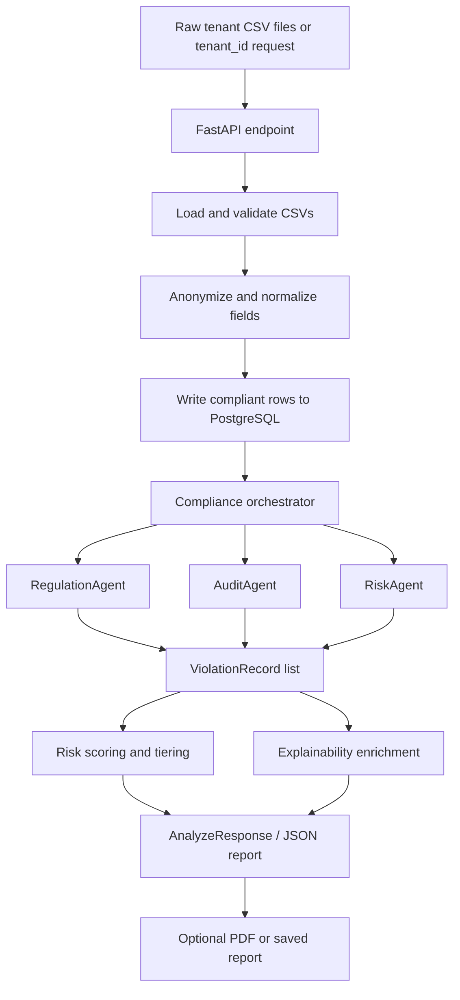
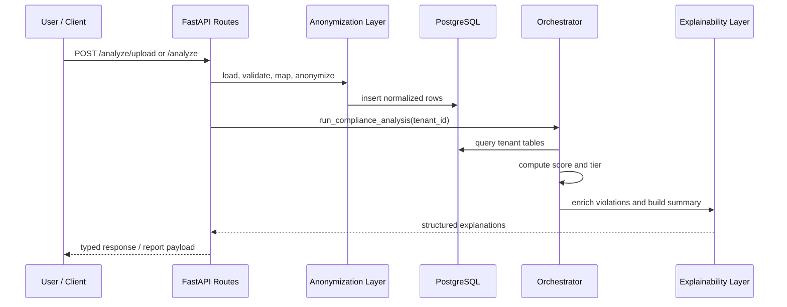

# Workflow

This document describes the end-to-end lifecycle of the compliance system in `src/`. The system is not model-driven in its live path; it is a database-driven rule engine with a privacy-preserving ingestion layer and a deterministic explainability layer.

## High-Level Diagram

## Complete Lifecycle

### 1. Intake

The system starts in `src/api/routes.py`. There are two operational paths:

- `POST /analyze` for analyzing an existing tenant already in the database.
- `POST /analyze/upload` for ingesting fresh CSVs, anonymizing them, persisting them, and then analyzing the tenant.

In both cases, `tenant_id` is the key that keeps all records isolated.

### 2. Validation and loading

For uploads, the API writes the incoming files to a temporary directory and calls `load_tenant_csvs()` from `src/anonymization/csv_loader.py`.

This layer:

- checks that all expected CSV files exist,
- enforces required columns,
- filters rows by `tenant_id`,
- removes suppressed columns,
- rejects malformed input early.

This is the first gate in the lifecycle and protects the rest of the pipeline from dirty or cross-tenant data.

### 3. Anonymization and normalization

The loaded data is passed to `anonymize_dataframe()` in `src/anonymization/field_mapper.py`.

This layer transforms raw tenant data into compliant database records by applying the system’s privacy techniques:

- hashing joinable identifiers,
- truncating timestamps to dates,
- validating and normalizing enums,
- bucketing user counts,
- suppressing unnecessary raw fields.

Each table has its own anonymizer, so the data is shaped to the target schema rather than copied blindly.

### 4. Persistence

`write_tenant_data()` in `src/anonymization/db_writer.py` inserts the mapped records into PostgreSQL in one transaction.

Important properties of this phase:

- inserts happen in the order required by foreign keys,
- placeholder rows are created when needed to preserve joins,
- the whole write rolls back if any table insert fails,
- the database becomes the single source of truth for analysis.

### 5. Compliance analysis

After persistence, the orchestrator in `src/agent_layer/orchestrator.py` runs the compliance engine.

It opens one database connection and executes three agents:

- `RegulationAgent` checks consent, purpose limitation, notice, and children’s data.
- `AuditAgent` checks retention, grievance mechanism, DSAR erasure, audit logging, and access control.
- `RiskAgent` checks third-party sharing, minimization, encryption, and breach notification.

Each agent produces `ViolationRecord` objects, defined in `src/agent_layer/violation_record.py`.

### 6. Risk scoring

The orchestrator computes a tenant-level risk score from the violations.

The scoring step is meant to answer:

- how many distinct rules were violated,
- how severe the violations are,
- how much regulatory exposure they represent,
- what tier the tenant belongs to.

The output is a score and tier such as `LOW`, `MEDIUM`, `HIGH`, or `CRITICAL`.

### 7. Explainability

The explainability layer in `src/explainability/service.py` converts raw violation records into structured explanations.

For each violation, it adds:

- what happened,
- why it is a DPDP violation,
- which signals triggered the rule,
- which signal contributed most,
- what remediation should happen first.

This layer is deterministic and rule-based. It does not call an external model. Its job is to interpret the compliance decision, not to make the decision itself.

### 8. Response construction

`src/api/routes.py` combines the analysis result and explainability output into the final `AnalyzeResponse` defined in `src/api/schemas.py`.

The response includes:

- tenant identity,
- unique rules violated,
- total violation occurrences,
- risk score and tier,
- structured violations,
- agent breakdown,
- remediation priority,
- total penalty exposure,
- executive summary.

### 9. Reporting

The same workflow can also be run outside the HTTP API.

- `src/main.py` runs a CLI-style compliance check and writes a compact report.
- `src/explainability/runner.py` runs the full analysis and report-building flow.
- `src/explainability/report_builder.py` can generate and save richer JSON reports.

## Folder Roles in the Lifecycle

### `src/anonymization`

Prepares raw tenant data for safe persistence. This is the privacy and schema-normalization layer.

### `src/api`

Exposes the workflow over HTTP and coordinates ingestion, analysis, and response formatting.

### `src/agent_layer`

Contains the core compliance decision engine. This is where rule evaluation and risk scoring happen.

### `src/explainability`

Transforms raw violations into legal and operational explanations, summaries, and remediation guidance.

### `src/modeling`

The current files in this folder are empty and not part of the live workflow.

## Practical Reading of the Lifecycle

In plain terms, the system works like this:

1. A tenant sends data or requests analysis.
2. The data is validated and anonymized.
3. The anonymized data is written into PostgreSQL.
4. Rule agents inspect the database and generate violations.
5. The orchestrator scores the findings.
6. The explainability layer turns violations into readable remediation guidance.
7. The final response or report is returned to the user.

## Key Design Properties

- Tenant isolation is enforced through `tenant_id`.
- The compliance engine is deterministic, not probabilistic.
- The anonymization layer is the only place where raw input is transformed.
- The agents only read data; they do not mutate it.
- The explainability layer adds meaning, not new detections.

## Short Summary

The workflow is: ingest -> validate -> anonymize -> persist -> analyze -> score -> explain -> report.